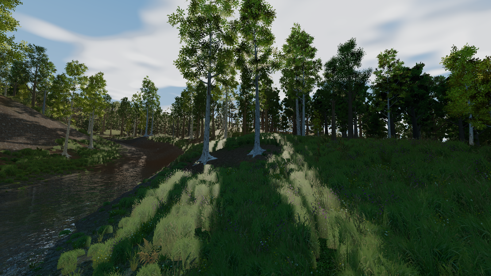

# RustBakedVoxelLighting

Native Rust woodland renderer using **direct Vulkan through ash**. The active application does not use Bevy, wgpu, Three.js, or a browser. It requests Vulkan 1.3 and runs on a compatible Vulkan 1.3/1.4 driver.

## Download the Windows preview

Download `RustBakedVoxelLighting-v0.1.0-windows-x64.zip` from the [Releases page](https://github.com/SamG-Coder/RustBakedVoxelLighting/releases), extract the **entire** archive, and run `woodland.exe` inside its folder. All world data, textures and compiled shaders are included. Rust and the Vulkan SDK are only needed to build from source.

Requires 64-bit Windows, a Vulkan 1.3-capable GPU/driver with the renderer's required features, and the [Microsoft Visual C++ x64 runtime](https://aka.ms/vs/17/release/vc_redist.x64.exe). Hardware ray queries enable the local GI cache and ray reflections; otherwise the renderer uses its raster/baked lighting path. Tested on an RTX 5080; other GPUs are not yet validated. Allow several seconds for startup, asset uploads and acceleration-structure construction. This is a development preview with a simple keyboard interface, not a finished game.



## Build and run

Requirements: Rust 1.98 (pinned in `rust-toolchain.toml`), a C++ linker, Vulkan drivers, and Vulkan SDK `glslc` on PATH. The SDK compiles the GLSL shaders to SPIR-V during the Cargo build. Large generated world assets live in the release archive rather than Git history; the download helper verifies the published SHA-256 before extracting them. Existing local assets are left intact.

```powershell
git clone https://github.com/SamG-Coder/RustBakedVoxelLighting.git
cd RustBakedVoxelLighting
powershell -ExecutionPolicy Bypass -File tools/fetch-assets.ps1
cargo run --release -p woodland
```

- Enter: walking mode; F: free flight.
- WASD: movement; Q/E: descend/ascend in flight; Shift: faster movement.
- Mouse: look while captured; Esc: release capture.
- N: jump 12 hours; P: pause/resume the 24-minute day; [ / ]: adjust the hour.
- R: wet/dry weather transition; X: screen-space reflections / ray reflections / ray reflections plus shadows.
- Frame rate and draw/page counts appear in the window title.

The native menu and controls are currently a development interface. They do not yet reproduce the browser's full menu/settings system.

## Separation of responsibilities

`crates/engine` owns Vulkan setup, GPU resource lifetime, texture uploads/mipmap generation, graphics pipelines, shadows, presentation, screenshot readback, and bounded cancellable CPU jobs. It accepts renderer-neutral geometry, materials, instances, draw ranges, and shader modules. It has no woodland-generation dependencies.

`crates/woodland` owns world import, terrain/ecology sampling, grass generation and habitat colours, plant LOD/visibility decisions, shaders, camera controls, and day/night policy. This crate depends on the engine, never the reverse.

The earlier Bevy renderer is retained under `experiments/bevy-preview` for comparison only. It is excluded from the active workspace.

## Implemented in the Vulkan renderer

- Exact exported 4 km × 4 km terrain fields and plant placements from the browser project.
- Shared prototype meshes and instanced draws for near trees and bushes.
- Three source mesh LODs and a fourth, baked impostor representation with object-space normal lighting.
- Mipmapped sRGB albedo and linear normal textures; 4× MSAA; complementary dithered LOD transitions.
- Frustum culling of geographic pages and bounded near-plant selection.
- Two worker threads for grass generation, six bounded outstanding jobs, stale cancellation, and one page upload per frame.
- Fixed 128 near + 768 distant grass slots, two persistent staging buffers, and fence-protected resources. The arena reserves 11.2 million vertices and 24.3 million indices; restoring curved crossed cards does not reduce plant density.
- All twelve source ground-cover species, original base/accent candidate counts, habitat-dependent heights, widths and colours.
- Per-pixel path/root/slope/canopy masks, woodland litter, source world-space texture variation, and terrain normal detail.
- RGBA16F HDR scene, shared GGX dielectric lighting, linear water/reflection composition and one final ACES pass.
- Imported bark/available leaf normal maps, source bark tiling, and offline alpha-weighted, coverage-preserving foliage mip chains.
- Raster terrain uses explicit UV gradients with anisotropic filtering; ray-hit terrain uses explicit mip levels. Rough ground sky reflection excludes the sharp sun/moon disks already evaluated by direct lighting. Damp litter retains high roughness.
- Three-segment curved grass cards, species normal/transmission atlas, source wind timing and a raised grass shadow receiver.
- Tree origins and grass-card base edges sample the actual rendered terrain triangles. Root collars follow a fine 2049-square terrain lookup in the colour and raster shadow passes; the ray-tracing prototype roots remain an approximation of that deformation.
- Two texel-snapped 2048-square directional shadow cascades (128 m and 512 m widths) in a 4096 x 2048 atlas, with filtered overlap, independent caster culling, solid depth-only passes, and front-to-back cutout batches. Vegetation light transmission, animated grass and procedural sky remain enabled.
- Half-resolution, depth-aware volumetric light shafts sampled from the tree/leaf shadow map, with Beer-Lambert attenuation and a Henyey-Greenstein phase function. Fixed three-metre integration intervals (up to 43 samples), stable shadow filtering, no animated sample noise or frame-history buffers. Changing foliage depth truncates the ray instead of moving its entire sampling lattice.
- Whole-map directional one-bounce transfer coefficients, evaluated for the current sun/moon without a frame-time rebake. This is a coarse canopy/terrain approximation, not path-traced GI.
- Ray-query diffuse GI around the camera: 24 x 12 x 24 world-aligned probes at 8 m spacing, toroidal persistent storage, 64 rays per updated probe, and 256 probe updates per frame. Directional radiance and six-axis distance moments provide visibility-weighted interpolation. History accumulation, readiness fade and sun-state validation suppress abrupt cache changes. The device-local cache is fixed at about 1.37 MiB.
- One shader lighting model for near geometry and distant normal-mapped impostors. The local GI cache blends back to the full-map transport outside its supported region; distant geometry always retains lighting.

## Remaining parity work

The renderer now has a whole-map Vulkan transport bake, terrain-horizon/bent-sky bake, shadow maps, terrain/foliage transmission approximation, screen-space plus optional ray-query water reflections, depth absorption, wetness, a 24-minute day/night cycle, moon/stars and world-space cloud shadows. Near ground shading combines the detailed horizon/canopy field with the coarse 3D bake. Ray-hit terrain uses the same surface blend and wetness as raster terrain. River corridors have locally refined, edge-matched terrain geometry. Grass uses 12 source species, shared habitat colour for near/far/ground LODs and offline albedo/normal atlases.

This remains a native rendering development build, not full browser/gameplay parity. The atmosphere is a layered procedural approximation, not volumetric cloud ray marching. The full-map transport uses coarse canopy proxies. The local ray-query cache traces terrain and tree/shrub geometry for one-bounce diffuse lighting, but does not yet implement recursive multi-bounce transport, probe relocation, or per-blade grass ray-tracing geometry. Grass receives the cached light. This is a DDGI-inspired implementation, not Unreal Lumen or an integration of the NVIDIA RTXGI SDK. Ray shadows are optional binary queries with raster filtering, not denoised area-light shadows. DLSS/DLAA/Ray Reconstruction/Frame Generation are not integrated. Torches, audio, full menus and gameplay interactions remain to be ported. Native placement seeds mean this is not pixel-identical to the browser.

Direct Vulkan does not automatically enable ray tracing or make every scene faster. This implementation reduces object-management overhead and provides explicit control of uploads and synchronization. Future GPU-driven rendering and lighting can be added behind the engine interface.

## Content workflow

Native runtime loads `assets/world` and `assets/textures`; no JavaScript executes at runtime. `tools/export-reference.mjs` exports the source world from `D:\BakedVoxelLighting`. `tools/bake-impostors.py` captures albedo and object-space normals from the exported source meshes. Run `python tools/bake-grass.py` to rebuild the source species/colony colour and normal atlas, then `python tools/bake-foliage-mips.py` after changing foliage PNGs. The latter writes `.mips` sidecars with source fingerprints, linear alpha-weighted colour and coverage adjustment. Stale sidecars fail with a clear rebake instruction. These are development/import tools, not frame-time work. Set `BVL_ASSETS` to override the native asset directory.

## Validation and repeatable capture

```powershell
cargo test --workspace
$env:BVL_VALIDATION = '1'
$env:VK_LAYER_VALIDATE_SYNC = '1'
$env:BVL_CAPTURE = 'D:\RustBakedVoxelLighting\evidence\vulkan-check.png'
$env:BVL_AUTOWALK = '1'
$env:BVL_PROFILE_SECONDS = '35'
cargo run --release -p woodland
```

The scripted traversal advances across the real terrain while grass generation and streaming remain active. It captures at 18 seconds, reports frame-interval percentiles after the initial five seconds, and exits at the configured duration. Capture readback/PNG writing is synchronous and can affect a frame; normal gameplay does not perform readback. Remove these environment variables for interactive use. Validation layers add CPU overhead; frame intervals are not GPU-only timings or a long-run memory guarantee.


### Visual review captures

`BVL_RIVER_REVIEW=1` frames a riverbank; `BVL_GRASS_REVIEW=1` frames grass at walking eye height. `BVL_HOUR=1` starts at night and `BVL_WETNESS=1` starts wet. Capture logs report the actual client dimensions. GPU memory and draw population remain bounded, but curved grass and floating-point render targets use more memory than the flat-card LDR version. Compare identical resolution, camera and weather when profiling.

`BVL_LIGHT_REVIEW=1` looks through the canopy; use `BVL_HOUR=8` for morning shafts. The atmosphere integrates a thin local aerosol layer up to 128 metres, using detailed shadows nearby and coarse baked visibility at the shadow-map boundary. It does not add a fog wall to hide distant LODs. The transfer buffer is fixed at 80 MiB (256 × 256 × 16 probes), including directional bounce terms; the half-resolution RGBA16F volume costs about 6.7 MiB at 2560 × 1369. Night exposure adapts to time of day, without camera-dependent brightness pumping.

Scattering references: [NVIDIA, volumetric light scattering](https://developer.nvidia.com/gpugems/gpugems3/part-ii-light-and-shadows/chapter-13-volumetric-light-scattering-post-process), [PBRT, phase functions](https://www.pbr-book.org/3ed-2018/Volume_Scattering/Phase_Functions), and [PBRT, transmittance](https://www.pbr-book.org/4ed/Volume_Scattering/Transmittance). The implemented volume is a shadow-map ray march, not the radial screen-space blur described in NVIDIA's example.

### Local GI and shadow profiling

`BVL_GI=0` disables the local ray-query cache for an A/B comparison; the default enables it when ray queries are available. `BVL_GPU_PROFILE=1` adds fence-safe GPU timestamp queries for GI/uploads, shadows, scene/water, volume and tone mapping. Timestamp instrumentation can perturb overlap; compare ordinary frame intervals with it disabled. `BVL_PROFILE_SECONDS` now also supports timed runs without a screenshot. These options are read at startup.

The local cache retains world-cell history as the camera moves, rejects invalid cells and probes below the detailed terrain, filters radiance and depth moments over successive updates, and blends to coarse transport at its boundary. It is a bounded GPU workload with no probe readback in normal rendering. Probe updates are independent of raster shadows; the compute-to-fragment dependency is delayed until surface shading so the GPU can overlap independent work.

The shadow optimization retains both 2048-square cascades and the same geometry/alpha textures. Each cascade receives its own conservative caster list. Off-screen casters are kept when they can contribute to the light projection, but do not enter the camera draw list. Solid wood and terrain use a fragment-free depth pipeline; foliage keeps cutout rendering. Spatial depth batches improve front-to-back submission. Grass shadow fade uses card-local coordinates, preventing the wind from reseeding its visibility pattern. Root texture upload barriers include vertex-stage readers.

Measured dense-canopy review on the RTX 5080, 1600 x 900 with validation enabled: the initial two-cascade build was 24.96 ms median / 25.84 ms p95; the optimized build was 17.15 ms median / 17.99 ms p95 / 18.46 ms p99. These are short runs with wind and the day cycle active, not a locked-60 guarantee. Evidence is in `evidence/gi-cascades-filtered.log` and `evidence/gi-optimized-day.log`.

Design references: [Epic's Lumen technical details](https://dev.epicgames.com/documentation/en-us/unreal-engine/lumen-technical-details-in-unreal-engine) and [NVIDIA RTXGI visibility-weighted irradiance sampling](https://github.com/NVIDIAGameWorks/RTXGI-DDGI/blob/main/rtxgi-sdk/shaders/ddgi/Irradiance.hlsl). Further work includes multi-bounce probe transport, better probe relocation in thin geometry, and denoised soft ray shadows. The current cascades and probe cache are a practical foundation, not a claim of full Lumen feature parity.

Final validation also covered a 30-second scripted walking run with live streaming (15.27 ms median / 16.44 ms p95 / 16.97 ms p99) and the night review (14.14 / 14.98 / 15.40 ms), both at 1600 x 900 with validation enabled. Their logs are `evidence/gi-optimized-walk.log` and `evidence/gi-optimized-night.log`; both Vulkan validation error logs are empty. Ten workspace tests and strict Clippy pass. These short runs do not establish a long-session memory or universal frame-rate guarantee.

### Parallel GI update optimization (2026-10-31)

The former GI kernel launched eight groups / 256 invocations, with each invocation tracing all 64 rays for one probe serially. The updated kernel launches one 32-thread workgroup for each of the same 256 probes. Each lane traces two of the original spherical rays, then the group reduces SH radiance, six directional distance moments and backface counts in 5 KiB shared memory. Only lane zero updates the persistent probe record. Uniform below-ground rejection remains before the barriers. This requires no subgroup-size assumption or atomics.

The sample directions, 64 rays/probe, 256 probes/frame, cache dimensions, history weights and visibility filter are retained. Parallel reduction changes floating-point summation order, so numerical results are equivalent within rounding rather than bit-identical. Geometry, grass populations, texture mip chains, 4x MSAA and both 2048-square shadow cascades are unchanged.

Matched RTX 5080 / 1600 x 900 canopy review, hour 7, 24-second runs with normal wind/day progression, validation off and GPU timestamps on:

| Metric | Serial probe rays | Parallel probe rays |
| --- | ---: | ---: |
| Median frame interval | 17.20 ms | 15.34 ms |
| p95 frame interval | 17.87 ms | 15.86 ms |
| p99 frame interval | 18.14 ms | 16.46 ms |
| Typical steady GI/update timestamp | 1.74-2.02 ms | 0.10-0.15 ms |

This is a 10.8% median frame-time reduction (58.1 to 65.2 FPS reciprocals), without reducing samples. The GI timestamp also includes preceding uploads; it is not a hardware occupancy-counter measurement. Evidence: `evidence/perf-research/baseline.log`, `parallel-rays.log`; the original executable and shader are retained alongside them for reproduction. Initial setup/bakes are excluded from the frame-interval window, which starts at five seconds. These short tests are not a universal 60-FPS or long-session guarantee.

An R8-only shadow opacity experiment copied every original alpha/mip value into a compact texture. It produced essentially the same 15.34 ms median / 15.87 ms p95 and required additional texture memory, so it was removed. Its log is `evidence/perf-research/opacity.log`. The shipping renderer still uses 34 textures.

Research used: [NVIDIA Vulkan performance recommendations](https://developer.nvidia.com/blog/vulkan-dos-donts/), [GPU bottleneck analysis](https://developer.nvidia.com/blog/the-peak-performance-analysis-method-for-optimizing-any-gpu-workload/), and [memory/resource guidance](https://developer.nvidia.com/blog/advanced-api-performance-memory-and-resources/). The measured remaining costs are shadows (~7.5-8.4 ms) and scene/water shading (~7-8 ms). Next investigations should use GPU hardware counters to distinguish vertex throughput, alpha overdraw and shader register/texture stalls; material-specific shader specialization and shadow submission changes need measured evidence before adoption. Lower shadow resolution, fewer probes or less grass are not part of this optimization.

Validation after the change: all 10 workspace tests, strict Clippy and the release shader/Rust build pass. Day (24 seconds), night (24 seconds) and walking/streaming (30 seconds) ran with Vulkan and synchronization validation enabled; all three stderr logs are empty. Frame intervals for these validation runs were day 15.34/16.03/16.50 ms, night 12.70/13.35/13.75 ms and walking 15.08/16.43/16.93 ms (median/p95/p99). Capture readback can affect a frame. Screenshots and logs are `evidence/perf-research/validated-{day,night,walk}.*`.

## Releases and licensing

Code is MIT licensed; see [LICENSE](LICENSE). Generated assets come from the author's [BakedVoxelLighting](https://github.com/SamG-Coder/BakedVoxelLighting) project; see [asset provenance](docs/asset-provenance.md). No Kingdom Come game assets or NVIDIA SDK binaries are bundled. Third-party components retain their respective licences. `THIRD_PARTY_NOTICES.md` and the release's `THIRD_PARTY_LICENSES/` directory accompany the executable.

To package a new build, run `tools/package-release.ps1`. It builds the locked release, collects dependency licence files from Cargo metadata, packages the executable and current assets, and writes SHA256SUMS.txt under `dist/`. The initial public version is a preview; no test workflows have been added to GitHub Actions.

## Browser preview

[Run the Rust WebGPU build](https://samg-coder.github.io/RustBakedVoxelLighting/) · [Build and capability notes](docs/browser.md). No Three.js; shared Rust world code compiled to WebAssembly.
